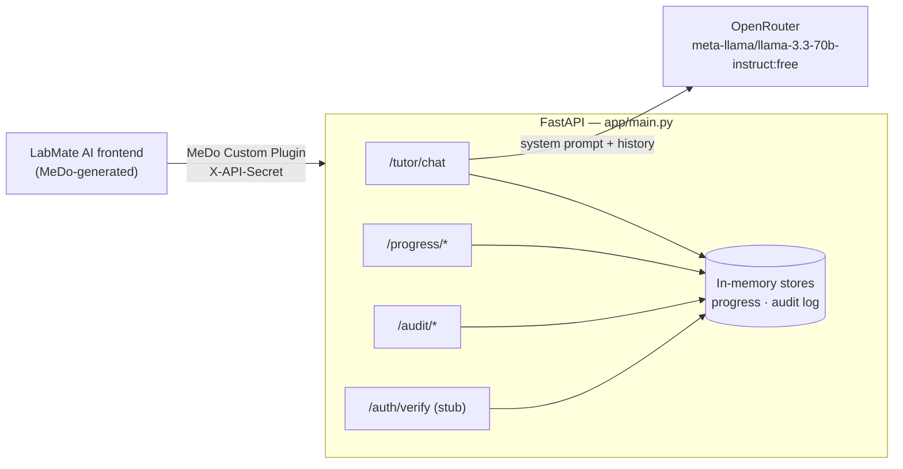

# LabMate AI Backend

**FastAPI service behind LabMate AI, a lab-instrument training app. It provides the "Dr. Ada" Socratic AI tutor (Llama 3.3 70B via OpenRouter), progress tracking and an audit trail, exposed to a MeDo-generated frontend as a custom plugin.**


-6E56CF)


[](LICENSE)

## Overview

LabMate AI was built for the **Build with MeDo Hackathon 2026**. Students walk through step-by-step scenarios on lab instruments (for example "ELISA Absorbance Reading" on a microplate reader). The frontend was generated with [MeDo](https://medo.dev) and calls this backend through a MeDo Custom Plugin.

This repo contains only the backend: a single FastAPI module (`app/main.py`, ~400 lines).

## Highlights

- **Dr. Ada tutor prompt**: the system prompt is built from the scenario context (instrument, scenario, step *n* of *N*). The tutor stays Socratic, keeps answers under ~120 words, and gives more direct hints as `hint_request_count` grows (2+, then 3+).
- **Troubleshooting mode**: when `troubleshoot_mode` is set, the tutor guides the student to diagnose an injected instrument fault instead of naming it.
- **Defensive LLM call**: a 25 s timeout, with timeouts mapped to `504` and provider errors to `502` with a truncated detail message.
- **Shared-secret auth**: an `X-API-Secret` header guards every endpoint except `/`, `/health` and `/docs`.
- **Audit trail**: tutor calls that include a `user_id`, progress updates and role checks all append an audit event.

## Architecture



## Endpoints

| Method | Path | Purpose |
|---|---|---|
| GET | `/` | Service info and endpoint list |
| GET | `/health` | Health check (also reports model and whether the LLM key is configured) |
| POST | `/tutor/chat` | Dr. Ada chat turn (via OpenRouter) |
| POST | `/auth/verify` | Role check (**stub**: always returns `ok: true` for the requested role) |
| GET | `/users/{user_id}/progress` | Fetch a user's per-scenario progress |
| POST | `/progress/update` | Update progress for a scenario |
| GET | `/audit/{user_id}` | Fetch a user's audit events |
| POST | `/audit/log` | Append an audit event |

<details>
<summary><b>Example: tutor request</b></summary>

```bash
curl -X POST http://localhost:8000/tutor/chat \
  -H "Content-Type: application/json" \
  -H "X-API-Secret: $API_SECRET" \
  -d '{
        "user_id": "student-1",
        "instrument_name": "Microplate Reader",
        "scenario_title": "ELISA Absorbance Reading",
        "step_number": 2,
        "total_steps": 6,
        "step_description": "Select the 450 nm filter",
        "messages": [{"role": "user", "content": "Why 450 nm?"}]
      }'
```

The full request and response schemas are in the Swagger UI at `/docs` and in [MEDO_PLUGIN_SPEC.md](MEDO_PLUGIN_SPEC.md).

</details>

## Project structure

```text
labmate-backend/
├── app/
│   ├── __init__.py
│   └── main.py            # FastAPI app: config, models, Dr. Ada prompt, OpenRouter client, endpoints
├── MEDO_PLUGIN_SPEC.md    # Text to paste into MeDo → Plugins → Create Plugin
├── render.yaml            # Render blueprint (free web service)
├── requirements.txt
├── runtime.txt            # python-3.11.9
├── .env.example
└── LICENSE
```

## Getting started

```bash
git clone https://github.com/rupeshbharambe24/labmate-backend.git
cd labmate-backend
python -m venv venv
source venv/bin/activate    # Windows: venv\Scripts\activate
pip install -r requirements.txt
cp .env.example .env        # add your OpenRouter key and choose an API_SECRET
uvicorn app.main:app --reload --port 8000
```

Open http://localhost:8000/docs for the Swagger UI. `.env` is loaded automatically with python-dotenv.

| Variable | Purpose |
|---|---|
| `OPENROUTER_API_KEY` | Key from https://openrouter.ai/keys |
| `OPENROUTER_MODEL` | Defaults to `meta-llama/llama-3.3-70b-instruct:free` |
| `API_SECRET` | Shared secret the frontend sends as `X-API-Secret` |

## Deploy to Render

1. In Render, choose **New → Blueprint** (or Web Service) and connect this repo. `render.yaml` provides the build and start commands.
2. Set the two secret env vars: `OPENROUTER_API_KEY` and `API_SECRET`.
3. Deploy, then put the public URL and the same `API_SECRET` into the placeholders in [MEDO_PLUGIN_SPEC.md](MEDO_PLUGIN_SPEC.md) and register the plugin in MeDo.

## Limitations

This was built as a hackathon demo:

- Progress and audit data live **in memory** and are lost on restart; a real database is needed for anything beyond a demo.
- `/auth/verify` is a stub that trusts the client-supplied role.
- CORS allows all origins (`*`).
- OpenRouter's free tier for Llama 3.3 70B is rate-limited.
- There are no automated tests.

## License

Released under the [MIT License](LICENSE).
